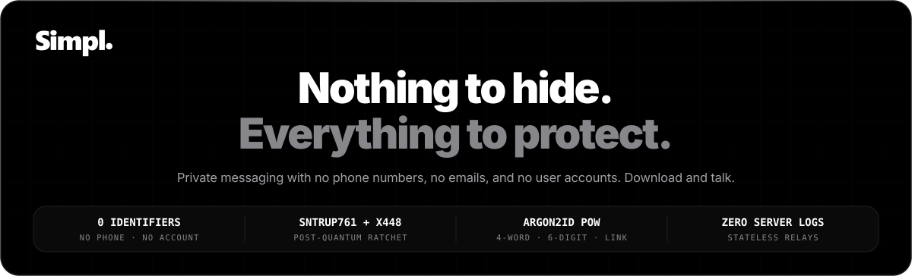
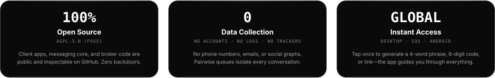
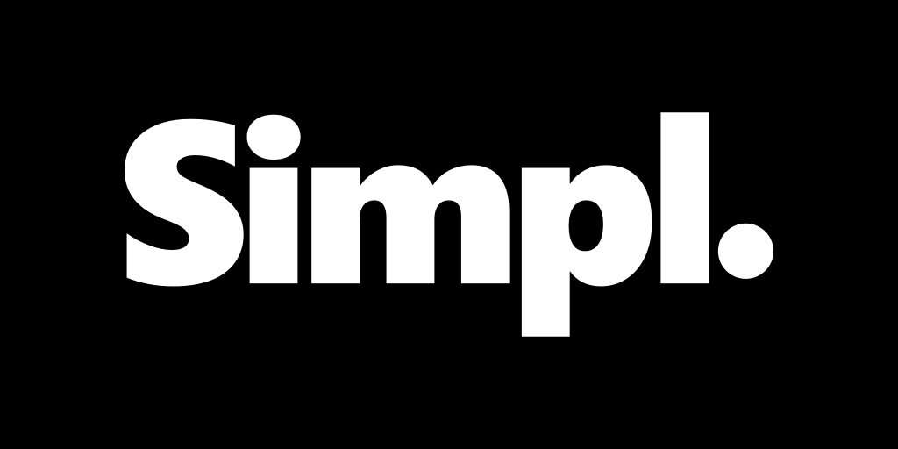

  

  
  
  
  
  
  

  

 

---

## Download

Zero is ready out of the box—no account signup, no phone number, and no configuration manual required. Open the app and it guides you through everything in seconds.

Installers and direct binaries are published via **[simpl.global](https://simpl.global)** and **[GitHub Releases](https://github.com/simpl-hq/zero/releases)**. Mobile App Store and Google Play listings are currently pending store review:

| Platform | Target | Channels |
| :--- | :--- | :--- |
| **`iOS`** | `iPhone & iPad` | App Store *(pending review)* · [simpl.global](https://simpl.global) · [GitHub Releases](https://github.com/simpl-hq/zero/releases) |
| **`Android`** | `ARM64 / ARMv7` | [Direct APK](https://github.com/simpl-hq/zero/releases) · Google Play *(pending review)* · [F-Droid](https://simpl.global) · [simpl.global](https://simpl.global) |
| **`macOS`** | `Apple Silicon & Intel` | [simpl.global](https://simpl.global) · [GitHub Releases (`.dmg`)](https://github.com/simpl-hq/zero/releases) |
| **`Windows`** | `Windows 10 / 11 x64` | [simpl.global](https://simpl.global) · [GitHub Releases (`.msi`)](https://github.com/simpl-hq/zero/releases) |
| **`Linux`** | `x86_64 / aarch64` | [simpl.global](https://simpl.global) · [GitHub Releases (`AppImage` / `.deb`)](https://github.com/simpl-hq/zero/releases) |
| **`CLI`** | `macOS / Linux / Windows` | [GitHub Releases](https://github.com/simpl-hq/zero/releases) |

---

## Trust Math. Not Promises.

Zero has no centralized identity database, no phone numbers, and no persistent user IDs. Every conversation runs on **two independent one-way streets**: Alice sends encrypted packets to Bob's chosen relay, and Bob sends to Alice's chosen relay. Relays never talk to each other, hold no account tables, and only forward fixed `16 KB` padded blocks across isolated pairwise unidirectional queues. See the full technical design in **[WHITEPAPER.md](WHITEPAPER.md)** or on **[simpl.global](https://simpl.global)**.

| Property | Relay Servers | Contact-Code Broker |
| :--- | :--- | :--- |
| `Phone number / email / username` | Never collected | Never collected |
| `Persistent user ID or account` | None exists | None exists |
| `Message & file plaintext` | End-to-end encrypted (`Curve448` + `sntrup761`) | Never handled |
| `Conversation metadata graph` | Pairwise unidirectional queues · optional 2-hop onion routing | Short ephemeral lookup TTL |
| `Local storage & retention` | Deleted on delivery or expiry · client-side `SQLCipher` AES-256 + `HMAC-SHA512` | 30-day phrase / 5-min in-person code |

### Security Model & Cryptography

Zero's threat model assumes network links and relay servers may be hostile:

- **Post-Quantum E2EE:** Augmented Post-Quantum Double Ratchet (`Curve448` + `sntrup761` KEM per ratchet step), `16 KB` fixed-size message padding, and chunked `XFTP` encrypted file transfers (`NaCl secret_box` + `SHA-512` digest verification).
- **Transport & Key Verification:** `TLS 1.3` with SPKI certificate pinning (`SMP` / `XFTP`), `Ed25519` signatures, `Argon2id` anti-spam proof-of-work, and out-of-band contact security-code verification to defeat MitM attacks.
- **Endpoint Scope:** Protocol and relay cryptography protect data in transit and at rest inside local encrypted storage, but **cannot** protect plaintext if an attacker gains physical access to an unlocked device or root access to the host OS—enable Face ID / App Lock / database passphrase inside Settings.

### Self-Hosting & Contributing

- **Self-Hosting:** Relays (`smp-server`, `xftp-server`), Docker Compose templates, and Caddy + Coturn configs live under [`scripts/relay/`](scripts/relay), [`deploy/`](deploy), and [`vendor/zeroq/`](vendor/zeroq).
- **Contributing:** Core logic is written in Haskell, bridged via C11 FFI to Kotlin Multiplatform (Android / Desktop) and SwiftUI (iOS), paired with a FastAPI contact broker. Read **[CONTRIBUTING.md](CONTRIBUTING.md)** to get started.

### Whitepaper & Security Review

Zero (`v1.0.0`) has **not yet completed an independent third-party audit**. Every component is open for inspection under `AGPL-3.0`:

| Resource / Component | Location |
| :--- | :--- |
| `Whitepaper` | [`WHITEPAPER.md`](WHITEPAPER.md) · [simpl.global](https://simpl.global) |
| `Release Changelog` | [`CHANGELOG.md`](CHANGELOG.md) |
| `Contributing Guide` | [`CONTRIBUTING.md`](CONTRIBUTING.md) |
| `Privacy Policy` | [`PRIVACY.md`](PRIVACY.md) |
| `Messaging Core & C FFI Boundary` | [`src/Zero/Chat/Mobile.hs`](src/Zero/Chat/Mobile.hs) · [`apps/multiplatform/common/src/commonMain/cpp`](apps/multiplatform/common/src/commonMain/cpp) |
| `Contact Broker & PoW Solvers` | [`apps/zero-pin-broker/main.py`](apps/zero-pin-broker/main.py) · [`ZeroIdentityBridge.kt`](apps/multiplatform/common/src/commonMain/kotlin/app/zero/core/network/ZeroIdentityBridge.kt) · [`ZeroInfo.swift`](apps/ios/Shared/Views/Onboarding/ZeroInfo.swift) |

---

## Brand & Assets

Official **Simpl.** mark is stored in `media-logos/`:

 

---

## Support Zero

Zero collects **zero user data. Ever.** No investors, no ads, no trackers. Development and stateless relay infrastructure are funded directly by the community at **[simpl.global/donate](https://simpl.global/donate)**:

 

| Channel | Address / Link |
| :--- | :--- |
| **`Buy Me a Coffee`** | [buymeacoffee.com/supportsimpl](https://buymeacoffee.com/supportsimpl) |
| **`Monero (XMR)`** | `47hCGy2csT1fJXMbsVtstXDqudH2M6tyeVQed9ob4vjgawLMnRqA5sNESBrGsfoiEQNCFWbohXsTG9JDfVWCh5KgVhTcrrL` |
| **`Bitcoin (BTC)`** | `bc1qwdz5r5vagtqq8mmn0wch2y6q5adk4ms84xj3es` |
| **`ETH / USDC (ERC-20, Base, Arbitrum, Polygon)`** | `0x96A103A67cB65c33673275FEFA29C77807E52605` |

---

**© 2026 Simpl.** Zero is free software licensed under the [GNU Affero General Public License v3.0](LICENSE). · [simpl.global](https://simpl.global) · [Donate](https://simpl.global/donate) · [WHITEPAPER.md](WHITEPAPER.md) · [CHANGELOG.md](CHANGELOG.md) · [CONTRIBUTING.md](CONTRIBUTING.md) · `support@simpl.global`

